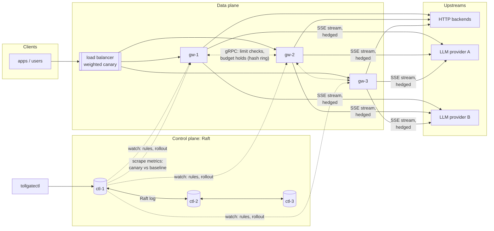

# Tollgate

A distributed AI gateway written in Go. A fleet of gateway nodes routes, protects and rate-limits traffic to LLM providers and ordinary backends. Policy is written in a small rule language compiled to bytecode, and config is replicated by a Raft control plane. The interesting parts are built by hand: the rule compiler and VM, the distributed rate limiter, Raft, and the streaming safety filter. Every claim below comes from a script in `bench/`.

## Architecture



- **Request path.** A gateway matches the route, then runs the rule bytecode in its VM (auth, limits, budgets, headers). Limits and budgets are checked on the node that owns the key on a consistent-hash ring, and the gateway proxies with load balancing, circuit breaking, retries and timeouts. Model calls stream through a safety filter, are hedged to a second provider when slow, and settle their real cost when the stream ends.
- **Config path.** `tollgatectl` sends rules to the Raft leader, which compiles and commits them. Every gateway watches the store and swaps rules atomically. A rollout goes to one canary gateway first; the leader compares the canary's errors and latency with the rest, then promotes or rolls back on its own.

| Component | Binary / package | Built by hand |
| --- | --- | --- |
| Gateway (proxy, LB, breaker, retries) | `tollgate-gw`, `internal/proxy`, `internal/lb`, `internal/breaker` | lock-free hot path |
| Rule language | `internal/rules/{lexer,parser,types,analysis,opt,compiler,vm,interp}` | lexer, Pratt parser, type checker, static analysis, optimizer, bytecode VM with verifier |
| Distributed rate limiting and budgets | `internal/ratelimit/{bucket,ring,peer,cost}` | token bucket, sliding window, hash ring, batched gRPC, reserve-and-settle |
| AI gateway | `internal/ai/{filter,hedge,providers,tokens}`, `mockllm` | Aho-Corasick streaming filter, hedged requests |
| Control plane | `tollgate-control`, `tollgatectl`, `internal/raft`, `internal/control` | Raft (election, PreVote, replication, snapshots, ReadIndex), WAL with fsync |
| Testing | `internal/sim`, `bench/` | deterministic whole-cluster simulation, mutation check, k6 and Go benchmarks |

## Results

<!-- results:start (generated by bench/report.go; do not edit) -->

| | Question | Laptop (Apple M2, shared) | CI runner (clean Linux VM) |
| --- | --- | --- | --- |
| E1 | How fast is the gateway? | 1 gw: 15000 req/s, 3 gw: 15000 req/s at p99 < 10 ms | 1 gw: 7500 req/s, 3 gw: 7500 req/s at p99 < 10 ms |
| E2 | Does bytecode beat tree-walking? | VM 2.56× the interpreter on 1000 rules; 0 allocs | VM 3.36× the interpreter on 1000 rules; 0 allocs |
| E3 | How accurate is distributed limiting? | over-admission +0.07% across 3 gateways (batched, 0.35 RPCs/req) | over-admission +0.00% across 3 gateways (batched, 0.25 RPCs/req) |
| E4 | Does consistent hashing minimize movement? | 23.5% of keys moved (ideal 25%), 0 misplaced; max/mean load 1.08 | 23.5% of keys moved (ideal 25%), 0 misplaced; max/mean load 1.08 |
| E5 | How does Raft behave? | commit p50 13.5 / p99 25.2 ms; failover p50 643 ms; 0 of 17842 writes lost | commit p50 1.5 / p99 2.9 ms; failover p50 548 ms; 0 of 155248 writes lost |
| E6 | How fast does config reach gateways? | config on all gateways p50 4.8 / p99 16.1 ms after commit | config on all gateways p50 1.6 / p99 8.9 ms after commit |
| E7 | Does the breaker protect latency? | client errors 16.7% → 1.4% with the breaker | client errors 16.5% → 1.3% with the breaker |
| E8 | Do cost budgets hold? | overspend -0.17% (reserve-and-settle) vs +14.8% (count limit); 0 leaked holds | overspend -0.24% (reserve-and-settle) vs +10.5% (count limit); 0 leaked holds |
| E9 | Does hedging cut tail latency? | TTFT p99 -49% for +0.77% cost (5% hedge budget) | TTFT p99 -49% for +0.76% cost (5% hedge budget) |
| E10 | What does the safety filter cost? | 34 MB/s with 10000 patterns; split-pattern recall 100% | 30 MB/s with 10000 patterns; split-pattern recall 100% |
| E11 | Does safe rollout catch bad config? | bad configs rolled back in 1.2–2.7 s; 12/12 decisions correct | bad configs rolled back in 1.2–2.2 s; 12/12 decisions correct |
| SIM | Does Raft stay safe under seeded faults? (deterministic simulation) | 5000 seeds × 2 suites pass; planted Raft bugs caught: true | 5000 seeds × 2 suites pass; planted Raft bugs caught: true |

Full tables, methods and environments: [docs/METRICS.md](docs/METRICS.md).

<!-- results:end -->

## Quick start

```sh
make build        # bin/: tollgate-gw, tollgate-control, tollgatectl, mockbackend, mockllm
make race         # all tests with the race detector
make fuzz-smoke   # 30 s per fuzz target

make up           # docker-compose: 3 control nodes, 3 gateways, backends, 2 mock LLMs,
                  # Prometheus (:9095), Grafana (:3000); rules pushed by rules-init
deploy/compose-check.sh   # bring the stack up and check it end to end (what CI runs)

bin/tollgatectl -endpoints localhost:7201 status
bin/tollgatectl -endpoints localhost:7201 rules rollout deploy/rules.tg gateway-1   # canary, auto promote/rollback
curl -N -H 'Authorization: Bearer demo-pro-key' localhost:8080/v1/chat/completions \
  -d '{"model":"m","max_tokens":50,"stream":true,"messages":[{"role":"user","content":"hi"}]}'
make down
```

## Reproducing the numbers

- `go run ./bench/run <e1…e11|sim>` runs one experiment as local processes and writes `bench/results/<exp>-<date>.json` with the environment (commit, machine, Go and k6 versions, power source, load average).
- `go run ./bench/report.go` regenerates `docs/METRICS.md` and the table above from those files.
- `.github/workflows/bench.yml` runs every experiment on clean GitHub-hosted runners (edit `bench/ci-run` to start it); those results are labelled `ci-runner`.
- `python3 bench/sim/mutants.py` plants five classic Raft bugs and checks the simulator catches each.

## Documents

- [`docs/SPEC.md`](docs/SPEC.md): the build spec.
- [`docs/DESIGN.md`](docs/DESIGN.md): plans, decisions, tradeoffs and what went wrong, milestone by milestone.
- [`docs/METRICS.md`](docs/METRICS.md): every measured number, generated from `bench/results/`.
- [`deploy/terraform/`](deploy/terraform/): the AWS (ECS Fargate + ALB) stack and its cost estimate.

## Limitations (honest list)

- **Not deployed to AWS.** The Terraform is written and `terraform validate`d but never applied, so there are no AWS numbers. Benchmarks ran on a laptop and on GitHub-hosted runners. In both, all nodes share one machine, so multi-node *scaling* is not demonstrated.
- **Missed goals, reported as measured:**
  - the bytecode VM reaches the 3× goal over a fair tree-walking interpreter on the CI runner's x86 CPU but not on the laptop's Apple M2 (E2; see the table);
  - canary exposure was 1/N with equal round robin (goal: under 1/N; the Terraform ALB weights the canary at 5%, untested);
  - a gateway crash mid-stream can overspend a budget by the unsettled partial cost of the cut streams (E8, kill run).
- **Not implemented:**
  - gateway cluster membership from the control plane (the hash ring comes from each gateway's static config);
  - OpenTelemetry tracing.
- **Rules ship as source**, compiled by the leader (to validate) and by each gateway, rather than as bytecode (see DESIGN.md).
